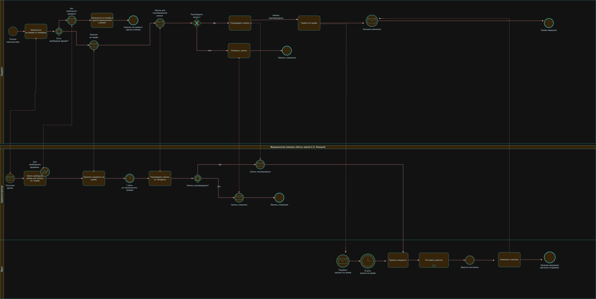
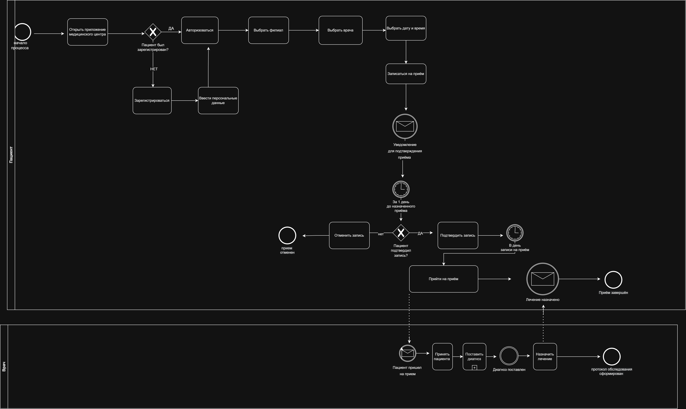
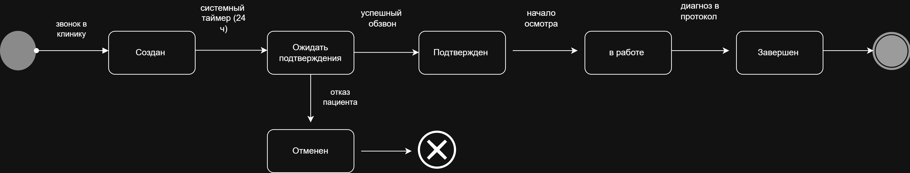
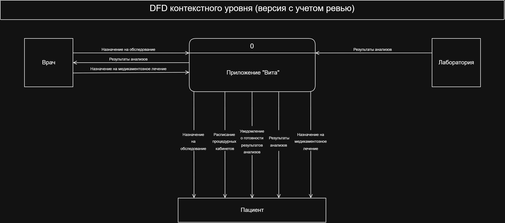
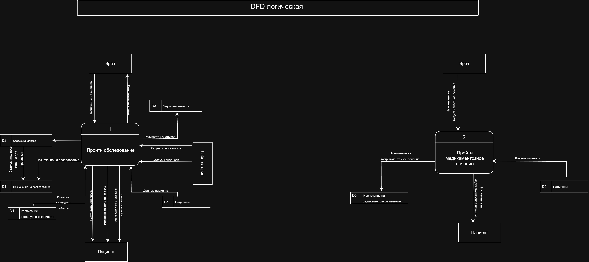
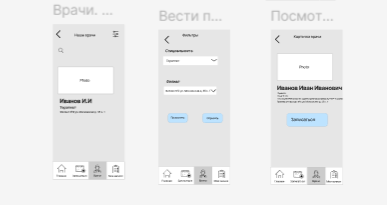
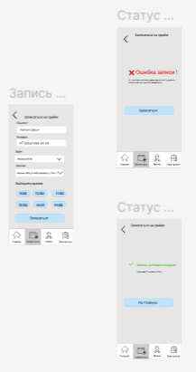
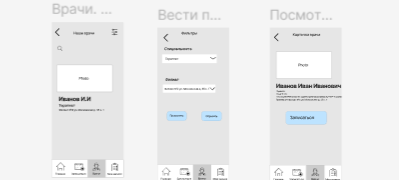
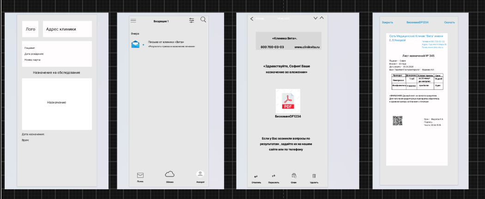
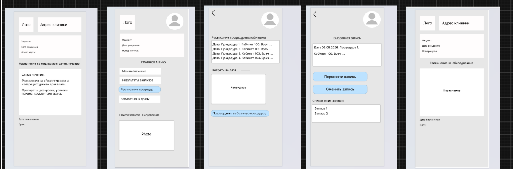

# 🏥 Моделирование процессов (BPMN 2.0), потоков данных (DFD), состояний (UML) и интерфейса для сети клиник «Вита»

## О проекте

**Заказчик** — сеть многопрофильных медицинских клиник **«Вита» им. Е.Л. Яницкой** (несколько филиалов в разных городах, целевая аудитория — пациенты со средним возрастом 30 лет).

**Цель проектирования** — анализ узких мест текущего процесса телефонной записи (AS-IS), реинжиниринг клиентского пути в формат самообслуживания через мобильное приложение (TO-BE), формализация потоков данных (DFD) и жизненного цикла заявки (UML State Machine) для передачи в разработку.

**Артефакты в репозитории:**
- схемы бизнес-процессов в нотации BPMN 2.0 (`AS-IS` и `TO-BE`);
- диаграмма состояний объекта «Запись на приём» (`UML State Machine`);
- диаграммы потоков данных (`DFD Level 0` и `DFD Level 1`);
- интерактивный прототип мобильного приложения (21 экран в Figma / Draw.io по 5 пользовательским сценариям).

## Заметки на полях

**Реинжиниринг процесса (AS-IS → TO-BE)**

1. **Исключение ручного труда администратора:** в целевой модели TO-BE роль «Администратор» полностью выведена из контура записи (процесс сокращён с 3 до 2 дорожек: `Пациент` и `Врач`). Поиск специалиста, фильтрация по филиалам и выбор временного слота перенесены в мобильное приложение.
2. **Автоматизация подтверждения визитов:** ручной обзвон пациентов накануне приёма заменён системным таймером (за 24 часа до визита) с отправкой push-уведомления для подтверждения или отмены записи в один клик.
3. **Разделение этапов работы врача и синхронизация потоков:** в пуле врача выделено промежуточное событие `Диагноз поставлен` для разграничения этапов осмотра и назначения лечения, а межпроцессный обмен между пациентом и врачом реализован строго через потоки сообщений (`Message Flow`).

**Архитектурные решения и допущения**

1. **Корректное завершение жизненного цикла в UML:** для однозначной реализации статусной модели в БД состояние `Отменён` замкнуто на узел прерывания потока (`Terminate`), что отделяет отменённые заявки от успешно завершённых приёмов (`Завершён`).
2. **Атомарность и сквозная нумерация в DFD:** соблюдено правило «одна стрелка — одна сущность данных», исключены пересечения линий, а для хранилищ введена сквозная нумерация (`D1`–`D6`) между уровнями модели.
3. **Границы скоупа (ограничения):** онлайн-оплата приёма и интеграция со сторонними страховыми шлюзами (ДМС) вынесены за рамки первой версии приложения — фокус сделан на записи, лабораторных анализах и электронных назначениях.

**AI-assisted**

В процессе работы применялись LLM-инструменты для валидации правил нотации BPMN 2.0 (разделение `Sequence Flow` и `Message Flow`), проверки полноты переходов в UML State Machine и согласования глоссария потоков между уровнями DFD.

## Ключевые выводы и результаты

- **-25% времени на запись пациента на приём** за счёт перевода поиска врачей и бронирования слотов в мобильное приложение (устранено ожидание ответа на телефонной линии).
- **100% автоматизация напоминаний и выдачи анализов:** подтверждение визитов работает по системному таймеру за 24 часа, а результаты лабораторных исследований доставляются пациенту в PDF по email и через push-уведомления.
- **Оптимизирована ролевая модель:** количество участников процесса записи сокращено с **3 до 2 ролей**, что разгружает администраторов филиалов для работы с очными пациентами.
- **Спроектирована модель данных и состояний:** описаны **6 статусов** жизненного цикла записи на приём в UML и **6 хранилищ данных (`D1`–`D6`)** в DFD для процессов диагностики и медикаментозного лечения.
- **Проработан пользовательский путь (21 экран):** собраны вайрфреймы в Figma/Draw.io с учётом негативных сценариев (ошибка бронирования занятого слота, перенос и отмена процедур).

## Визуализация архитектуры и прототипа

### 1. Бизнес-процессы записи и приёма (BPMN 2.0)

**Текущий процесс «Как есть» (AS-IS, 3 роли):**

**Ключевые особенности схемы AS-IS (3 роли):**
* **Ручная маршрутизация через администратора:** вся запись ведётся по телефону с ручным поиском свободного окна в электронном календаре и высоким риском потери пациента при отсутствии слотов.
* **Ручной обзвон пациентов:** за день до приёма администратор вынужден вручную обзванивать каждого записанного пациента для подтверждения явки.

**Целевой процесс самообслуживания (TO-BE, 2 роли):**

**Ключевые улучшения схемы TO-BE (2 роли):**
* **Самообслуживание в приложении:** роль администратора полностью исключена из процесса записи — пациент сам регистрируется, выбирает филиал, врача и свободное время.
* **Автоматический таймер и синхронизация потоков:** за 24 часа до приёма система отправляет push-напоминание, а этапы работы врача (осмотр, постановка диагноза и выдача назначений) связаны с пациентом через потоки сообщений (`Message Flow`).

### 2. Жизненный цикл записи на приём (UML State Machine)

**Ключевые решения на диаграмме состояний (UML State Machine):**
* **Жизненный цикл из 6 статусов:** зафиксированы все переходы заявки от создания (`Создан`) до успешного закрытия (`Завершён` после оформления протокола осмотра).
* **Системные триггеры и обработка отмен:** переход в статус `Ожидает подтверждения` запускается автоматически по таймеру за 24 часа, а при отказе пациента заявка переходит в статус `Отменён` с корректным прерыванием жизненного цикла (`Terminate`).

### 3. Диаграммы потоков данных (DFD)

**Контекстный уровень (Level 0):**

**Назначение контекстного уровня DFD (Level 0):**
* **Границы системы «Приложение Вита»:** определено информационное взаимодействие между приложением и тремя внешними сущностями — **Пациентом**, **Врачом** и **Лабораторией**.
* **Атомарность потоков данных:** все стрелки подписаны строго сущностями данных без глаголов-действий (назначения на обследование и лечение, расписание процедурных кабинетов, уведомления и результаты анализов).

**Логический уровень (Level 1: обследования и медикаментозное лечение):**

**Архитектура потоков данных на логическом уровне (Level 1):**
* **Декомпозиция на два ключевых процесса:** логика разделена на `Процесс 1` (прохождение обследований и сдача анализов) и `Процесс 2` (медикаментозное лечение).
* **Сквозная система хранилищ (`D1`–`D6`):** данные изолированы по шести базам (`D1` Назначения на обследование, `D2` Статусы анализов, `D3` Результаты анализов, `D4` Расписание кабинетов, `D5` Пациенты и `D6` Назначения на лечение) без пересечения потоков.

### 4. Вайрфреймы и макеты экранов мобильного приложения (Figma / Draw.io)

**Сценарий 1 — поиск врача, фильтрация по филиалам и карточка специалиста:**

**Сценарий 2 — оформление записи на приём и обработка статусов (успех / ошибка):**

**Сценарий 3 — электронные направления на обследование, лист назначений № 345 и PDF-результаты анализов:**

**Сценарий 4 — личный кабинет, расписание процедурных кабинетов и управление записью:**

**Сценарий 5 — выбор филиала, график работы кабинетов и уведомления о готовности анализов:**

## Методология и стек

- **Моделирование процессов:** BPMN 2.0 (анализ AS-IS и проектирование TO-BE).
- **Проектирование систем и данных:** UML (State Machine Diagram), DFD (Yourdon-DeMarco, Level 0 / Level 1).
- **Требования и прототипирование:** User Stories, User Flows, Figma, Draw.io, Git.

## Состав репозитория

| Файл | Описание |
| :--- | :--- |
| [bpmn-as-is.png.png](bpmn-as-is.png.png), [bpmn-to-be.png.png](bpmn-to-be.png.png) | Схемы бизнес-процессов записи и приёма в нотации BPMN 2.0 (AS-IS и TO-BE) |
| [uml-state-machine.png.png](uml-state-machine.png.png) | Диаграмма состояний объекта «Запись на приём» (UML State Machine, 6 статусов) |
| [dfd-context.png.png](dfd-context.png.png), [dfd-logical.png.png](dfd-logical.png.png) | Диаграммы потоков данных контекстного и логического уровней (хранилища `D1`–`D6`) |
| [clinic-screens-1.png.png](clinic-screens-1.png.png) — [clinic-screens-5png.png](clinic-screens-5png.png) | Раскадровка 21 экрана мобильного приложения по 5 пользовательским сценариям |
| `README.md` | Этот файл |
